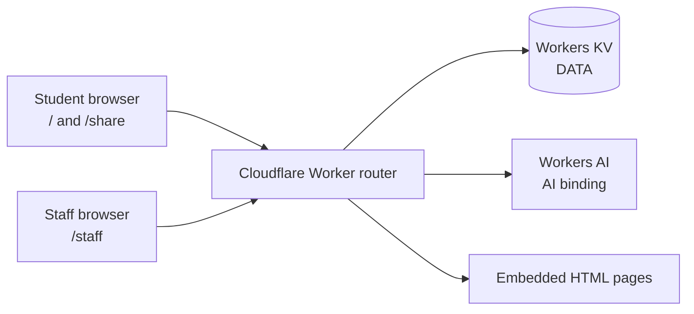

<!-- TODO before 1:45 PM (submissions close 2:00 PM): paste the video link. -->
# Coding in Color: Alumni Impact + Family Newsletter

A voluntary alumni update flow helps Coding in Color learn what students do after programs, while staff can review outcomes and prepare a family newsletter from Instagram posts and consented alumni stories.

**Team:** Pranit (solo) · **Nonprofit:** Coding in Color  
**Student page:** https://coding-in-color.coolpranit2009.workers.dev/  
**Staff portal:** https://coding-in-color.coolpranit2009.workers.dev/staff · **Demo staff passcode: `testpassword1`** (the live site holds fake demo data only; a real deployment sets its own with `npx wrangler secret put STAFF_CODE`)  
**Video:** [unlisted YouTube / Drive link]

## The problem

Coding in Color's #1 issue, shared in person, is that they do not know what students do after they leave, so they cannot show the impact of their programs. Announcements live only on Instagram, so families may miss them. The organization cannot store student data such as names of current students, so an alumni update must be voluntary and collect as little as possible.

Coding in Color reports that over 500 students have participated in its programs since 2024 and that more than 80% of participating students are from historically underserved backgrounds. Its home page says: “Talent is everywhere, opportunity is not”.

## What it does

- **Alumni share their story:** former students can submit what they are doing now, the programs they attended, and what the program helped with. First name is optional, and the student chooses whether their story may be featured.
- **Staff review and impact dashboard:** staff can review voluntary updates, see education and career outcomes, and track anonymous session headcounts and return rates.
- **Instagram posts to newsletter:** staff paste Instagram post details, optionally use AI to read images or transcribe a reel, then combine selected posts with consented alumni spotlights into a newsletter draft. They review and copy or download the draft for their email tool.
- **Anonymous session headcounts:** staff can record aggregate attendance and returning counts without storing student names.

### Alumni wall

The dashboard gallery shows only consented featured/reviewed alumni stories (with consented new updates used only to fill a wall with fewer than three stories); its cards are drawn from text and never use photos. OGL loads from jsDelivr at runtime; `prefers-reduced-motion`, unavailable WebGL, or import failures use a static horizontal gallery. Gallery adapted from an open-source CircularGallery component (OGL), ported to vanilla JS.


## Architecture



The Worker serves both HTML pages and all API endpoints from one deployment. The student browser posts a voluntary form to the Worker; the Worker validates it, optionally sends a photo to Workers AI for a description, then stores the update in KV. The staff browser uses the same Worker API to read and edit records, and the newsletter workflow sends selected content to the AI endpoint. The single Worker keeps routing, passcode enforcement, validation, AI calls, and KV access on the server while avoiding a separate backend service.

## Project structure

```text
.
├── build/
│   ├── apply_preset.py       # Replaces the staff app CONFIG block with a preset
│   └── build_worker.py       # Bundles Worker modules and HTML into worker.js
├── docs/
│   └── CONTRIBUTING.md       # Notes for extending routes and presets
├── src/
│   ├── index.html            # Generic config-driven staff application
│   ├── share.html            # Public alumni story form
│   ├── presets/              # Configurations (starter presets are examples; Coding in Color uses its own)
│   │   ├── bakery_demo.js     # Starter bakery example
│   │   ├── clients.js         # Starter client tracker
│   │   ├── coding_in_color.js # Active Coding in Color configuration and gallery
│   │   ├── directory.js       # Starter directory example
│   │   ├── donors.js          # Starter donor tracker
│   │   ├── events.js          # Starter event tracker
│   │   ├── pantry.js          # Starter pantry example
│   │   └── volunteers.js      # Starter volunteer tracker
│   └── worker/
│       ├── ai.js             # Allowlisted drafts and rate limiting
│       ├── alumni.js         # Public catalog and alumni submissions
│       ├── auth.js           # Staff lock and public route allowlist
│       ├── http.js           # Shared response/body/validation helpers
│       ├── index.js          # Worker router and entry point
│       ├── media.js          # Image, audio and newsletter AI routes
│       ├── pages.js          # Embedded HTML page responses
│       └── storage.js        # KV and generic entity API
├── tests/
│   ├── run_all.mjs           # Runs every test suite in child processes
│   ├── test_attention.mjs    # Needs-attention behavior
│   ├── test_t2_ai_actions.mjs # Allowlisted AI actions
│   ├── test_t3_media.mjs     # Media and newsletter API
│   └── test_t5_alumni.mjs    # Alumni submission and staff lock
├── screenshots/              # Share page, dashboard and newsletter captures
│   ├── dashboard.jpg         # Staff impact dashboard capture
│   ├── newsletter.jpg        # Newsletter builder capture
│   └── share.jpg            # Student share page capture
├── .gitignore                # Local secrets, builds and scratch files
├── LICENSE                   # MIT license
├── package.json              # Build, test, dev and deploy scripts
├── wrangler.toml             # Worker bindings and model configuration
└── worker.js                 # Generated single-file Cloudflare Worker
```

## API reference

When `STAFF_CODE` is configured, every API route requires the `x-staff-code` header except the routes marked **public** below. Without that secret, the API remains open as in the demo. `OPTIONS` requests return the existing permissive CORS preflight response.

| Method | Path | Auth | Request | Success | Common errors |
|---|---|---|---|---|---|
| `GET` | `/api/capabilities` | Public | — | `{storage, ai, media, staffLock}` | — |
| `GET` | `/api/ping` | Public | — | `{ok:true}` | `404` if KV is not bound |
| `GET` | `/api/public/programs` | Public | — | `{programs:[...]}` | — |
| `POST` | `/api/alumni/submit` | Public | Voluntary alumni fields described below; optional base64 image | `{ok:true}` | `400` invalid form, `403` foreign Origin, `429` rate limit, `502` image AI failure, `503` no KV |
| `POST` | `/api/ai` | Staff | `{action, record, org?}`; action must be allowlisted | `{text}` | `400` unknown action, `403` foreign Origin, `404` no AI, `429` limit, `502` AI failure/empty response |
| `POST` | `/api/media/describe` | Staff | `{image}` base64 or data URL | `{description, text_in_image}` | `400` invalid body/image, `403` foreign Origin, `404` no AI, `413` image over 2 MB, `429` limit, `502` AI failure |
| `POST` | `/api/media/transcribe` | Staff | `{audio}` base64 or data URL | `{text}` | `400` invalid body/audio, `403` foreign Origin, `404` no AI, `413` audio over 8 MB, `429` limit, `502` AI failure |
| `POST` | `/api/newsletter` | Staff | `{org?, period?, posts:[{date,caption,imageNotes,transcript,link}]}`; 1–12 posts | `{subject,preheader,intro,sections,cta}` | `400` invalid/empty/over-limit posts, `403` foreign Origin, `404` no AI, `429` limit, `502` invalid output or AI failure |
| `GET` | `/api/<entity>` | Staff | — | Array of records; empty array if missing | `404` if KV is not bound or entity path is invalid |
| `POST` | `/api/<entity>` | Staff | JSON object | Created record with generated `id` (`201`) | `400` invalid JSON or configured required field, `404` no KV |
| `GET` | `/api/<entity>/<id>` | Staff | — | Record | `404` no KV or record missing |
| `PUT` | `/api/<entity>/<id>` | Staff | JSON object merged into record | Updated record | `400` invalid JSON or configured required field, `404` no KV or record missing |
| `DELETE` | `/api/<entity>/<id>` | Staff | — | `{ok:true}` | `404` no KV or record missing |
| `GET` | `/api/_export` | Staff | — | Object keyed by entity, each value an array | `404` if KV is not bound |
| `POST` | `/api/_reset` | Staff | Object mapping entity names to arrays | `{ok:true}` after replacing all entity keys | `400` body is not an object, `404` if KV is not bound |

Unknown API methods return `405`; the outer Worker catches unexpected API errors and returns `{error:"Server error"}` with status `500`. Any non-API `GET` or `HEAD` serves the share page at `/` and `/share`, and the staff app for `/staff` and the existing fallback paths. Other non-API methods return `405`.

`POST /api/alumni/submit` accepts required `programs` (one to six names from the public catalog), `nowDoing` (one of the page's choices), and `story` (20–1,200 characters). Optional fields are `firstName` (up to 40 characters), `yearsAttended` (20), a four-digit `gradYear`, `field` and `school` (80 each), an HTTPS `link` (300), `proudOf` (300), and a JPEG/PNG `image` (up to 2 MB decoded). `consentShare` and `consentContact` default to false; `contact` (up to 120 characters) is stored only when contact consent is true. A non-empty `website` honeypot receives `{ok:true}` and stores nothing.

## Data model

Worker KV stores one JSON array per entity under `e:<entity>`:

- **`post`:** `id`, `title`, `date`, `kind`, `link`, `caption`, `imageNotes`, `transcript`, and `used`.
- **`session`:** `id`, `date`, `program`, `headcount`, `returning`, `families`, and optional aggregate `notes`. No student names belong in notes.
- **`issue`:** `id`, `subject`, `period`, `created`, `posts` count, `madeWith`, and plain-text newsletter `text`.
- **`update`:** `id`, `submittedAt`, `status`, optional first name, programs, years attended, graduation year, current activity, field, school/organization, story, link, proud-of note, consent flags, and optional contact. Optional photo descriptions are saved as `imageNotes`.

Program form input is validated against the Worker program list; submitted program names are stored as a comma-joined string. The system never stores raw images or audio. First name is optional and limited to one name token. Contact is kept only when `consentContact` is true. Demo records are fabricated examples, not real student data.

## AI pipeline

AI is optional and runs inside the Worker:

- **Image descriptions:** `@cf/meta/llama-3.2-11b-vision-instruct` (or `VISION_MODEL`). The Worker calls the model with a text prompt and an `image_url` whose URL is a `data:image/jpeg;base64,...` or PNG data URL inside the user message content. Raw photo bytes are not written to KV.
- **Reel transcription:** `@cf/openai/whisper-large-v3-turbo` (or `WHISPER_MODEL`), with a fallback to `@cf/openai/whisper` using a byte array if the first call fails.
- **Newsletter writing:** `@cf/meta/llama-3.3-70b-instruct-fp8-fast` (or `NEWSLETTER_MODEL`) receives bounded post fields and a fixed system prompt and returns structured newsletter JSON.
- **Allowlisted drafts:** `/api/ai` accepts only the fixed action definitions in `AI_ACTIONS` (including summaries, reminders, donor updates, check-ins and alumni spotlights). Its Worker AI model uses `AI_MODEL`; `wrangler.toml` sets this to `@cf/meta/llama-3.3-70b-instruct-fp8-fast`. The retired `llama-3.1-8b` is not the configured model.

Prompts are fixed in the Worker and say record content is data, not instructions. Records, organization fields, posts, and output sizes are clamped; newsletter output is parsed and shape-checked before returning. AI endpoints share a best-effort limit of 10 requests per minute per IP when KV is bound. If AI is unavailable, the newsletter UI offers a simple non-AI draft from saved captions and featured alumni stories; the AI endpoints return an error when unavailable.

The text-draft route also retains the starter's optional Anthropic fallback: if the Workers AI binding is absent and `ANTHROPIC_API_KEY` is configured, `/api/ai` uses `AI_MODEL` or `claude-haiku-5-5`. This fallback is separate from the Workers AI vision, transcription, and newsletter routes.

## Security and privacy

- Configure the shared staff passcode as a Worker secret with `npx wrangler secret put STAFF_CODE`; never place it in source code. The hackathon demo passcode is published above on purpose so judges can open the staff portal; the demo holds only fake data, and any real deployment must set a new secret. Comparisons loop over all character positions. The public exceptions are `GET /api/capabilities`, `GET /api/ping`, `GET /api/public/programs`, and `POST /api/alumni/submit`.
- AI and media routes reject a mismatched `Origin` header. The alumni endpoint also checks `Origin`; absence of the header is permitted.
- The alumni form validates selected programs, required story length, activity choice, HTTPS links, and optional photo type/size. The hidden `website` honeypot returns success without storing anything.
- Alumni updates are voluntary and consent-based. Name is optional; there is no required full name, email, or phone. Newsletter spotlights require both `consentShare` and staff review status `featured`, and use first name only.
- Photos are resized in the browser, optionally sent for an AI description, and discarded. Audio used for transcription is sent to the Worker and is not stored by the app.

## Configuration

`wrangler.toml` sets `main = "worker.js"`, the KV binding `DATA`, the Workers AI binding `AI`, and `AI_MODEL`. Configure `STAFF_CODE` with Wrangler Secrets when the portal should be locked. Do not add a secret value to `wrangler.toml`.

`src/presets/` contains reusable starter examples and the `coding_in_color.js` configuration. That preset defines the organization details, program names, theme, entities, fake demo rows, attention rules, and newsletter view. Apply it with `python3 build/apply_preset.py src/presets/coding_in_color.js`; the script replaces only the marked CONFIG block in `src/index.html`. Rebuild after changing the preset or either HTML page.

## Run, test, deploy

```sh
npm install
npm test
npm run dev
npx wrangler login
npx wrangler kv namespace create DATA
npx wrangler secret put STAFF_CODE
npm run deploy
```

The namespace ID created by Wrangler must be added to `wrangler.toml` under `[[kv_namespaces]]` before deploy. Cloudflare dashboard deployments can instead use the generated `worker.js`. To reset the current demo data, open **Settings → Reset demo data** in the staff portal.

## How we built it

The project started from Pranit's generic, config-driven starter template prepared before the event. The Coding in Color alumni share flow, public submission API, staff passcode lock, impact dashboard, consolidated staff views, image descriptions, reel transcription, newsletter workflow and documentation were built for this project. Claude acted as architect and reviewer, and Codex acted as builder through the JSON task protocol in `.agents/`. Each task was reviewed and tested; existing test suites remain unchanged.

## Status

**Finished:** voluntary alumni updates; consent-aware review and featuring; outcome dashboard; anonymous session headcounts; Instagram post entry; optional AI image descriptions and reel transcription; AI-assisted newsletter drafts with a simple fallback; CSV tools and KV export/reset.

**Mocked up:** demo posts, sessions and alumni records are fake; there is no real student outcome data in this repository. AI drafts need staff review.

**Next:** Instagram posts are pasted, not auto-pulled (automatic import needs a Meta Graph API token); newsletters are copied into the nonprofit's email tool, not sent; staff use a shared passcode rather than per-user accounts; possible next steps are Graph API import, email sending, individual staff logins, and Spanish editions.

## License

MIT. See [LICENSE](LICENSE).
