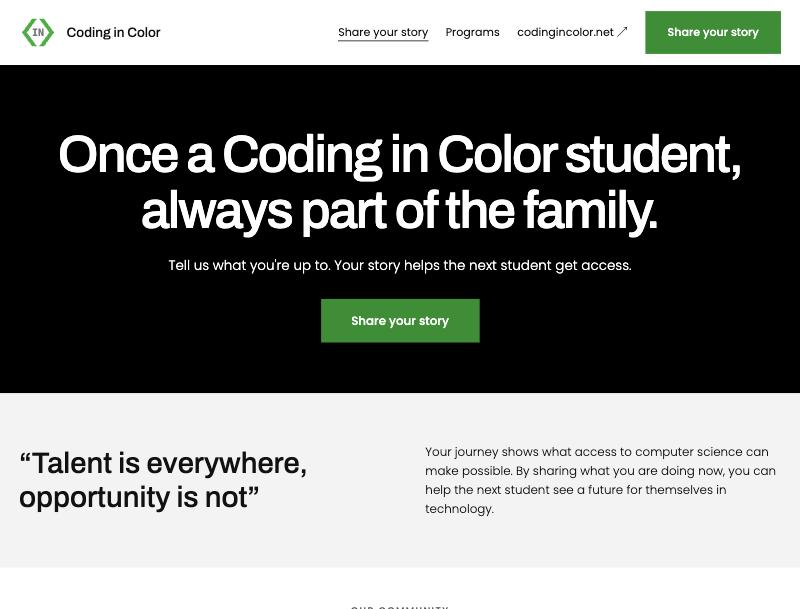
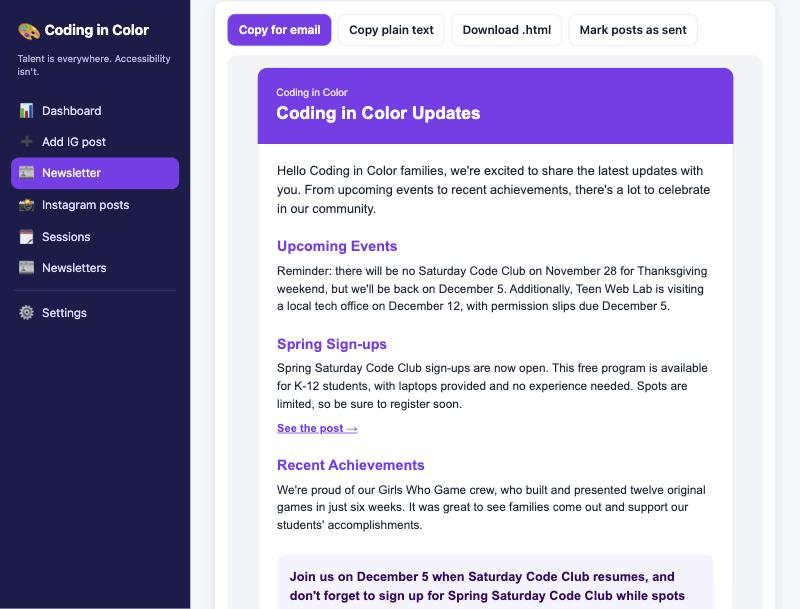

# Coding in Color: Alumni Impact + Family Newsletter

**Team:** Pranit (solo) · **Nonprofit:** Coding in Color  
**Live app:** https://coding-in-color.coolpranit2009.workers.dev  
**Video (3 min):** [unlisted YouTube / Drive link]

## The problem

Coding in Color cannot see what students do after they leave, so it is hard to show the long-term impact of its computer science and AI education for Arizona students. Announcements live only on Instagram, where families may miss them.

## How it works

1. Students return to the public page at `/` and voluntarily share what they are doing now, which programs they attended, and what Coding in Color helped them with.
2. Staff use `/staff` to review updates, see alumni outcomes and program trends, and manage Instagram posts and past newsletters.
3. The newsletter tool combines selected Instagram posts with consented featured alumni stories into a family email draft. Staff can review, copy or download the result.

Staff portal is passcode-protected; judges: the demo passcode is in our submission notes. It uses the Worker `STAFF_CODE` secret, so the portal remains open if that secret is not configured. The passcode value is not stored in this repository.

## Tech stack

- **Cloudflare Workers:** serves the public student page and staff app, plus the API.
- **Workers KV:** stores alumni updates, Instagram posts, session counts and past newsletters.
- **Workers AI:** `@cf/meta/llama-3.2-11b-vision-instruct` reads optional project photos, `@cf/openai/whisper-large-v3-turbo` transcribes reel audio, and `@cf/meta/llama-3.3-70b-instruct-fp8-fast` writes newsletters and alumni spotlights. AI calls stay in the Worker.
- **Public routes:** `GET /`, `GET /share`, `GET /api/public/programs`, and `POST /api/alumni/submit`.
- **Staff routes:** `/staff`; protected `/api` routes when the `STAFF_CODE` secret is set. Staff access is optional when that secret is absent.
- **Front end:** inline HTML, CSS and JavaScript with no added libraries. The student page resizes photos in the browser before upload; the Worker stores only an AI description, never the image.
- **Build:** `python3 build/apply_preset.py src/presets/coding_in_color.js` applies the staff app preset; `python3 build/build_worker.py` builds `worker.js`.

## Starter template and AI disclosure

The project began from a generic, config-driven starter template Pranit prepared before the event. The alumni share flow, staff portal consolidation, public submission API, passcode lock, impact dashboard and newsletter integration were built for Coding in Color. Claude acted as architect and reviewer, and Codex implemented the specified work through a JSON task protocol. All code was reviewed and tested.

## Status

**Finished:** voluntary alumni updates; consent-aware featuring; staff review and passcode handling; alumni outcome metrics and charts; Instagram post capture; AI-assisted newsletter drafts with a simple fallback; photo descriptions and reel transcription; session retention tracking; CSV import/export.

**Mocked / demo only:** all seeded alumni, posts and sessions are fake examples, not actual student records or measured organization outcomes. AI drafts need staff review. Newsletters are copied into the organization's email tool; the app does not send them.

**Next:** replace demo records with voluntary real alumni submissions; confirm staff access settings with the program lead; add Spanish-language newsletter drafts; connect Instagram's API or an email service if the organization wants those workflows automated.

## Privacy note

Alumni updates are voluntary and consent-based. First name is optional; the form does not require a full name, email or phone. Contact information is stored only when the student checks the contact-consent box. A story is featured only when the student gives sharing consent and staff mark the update featured. Photos are resized in the browser, sent for AI description when Workers AI is available, and discarded; only the description is stored. Do not submit another person's private information.

## Run locally

- Open `src/share.html` to inspect the public page design.
- Run `python3 build/apply_preset.py src/presets/coding_in_color.js` to apply the staff app preset.
- Run `python3 build/build_worker.py` to generate the Worker bundle.
- Run `npm run dev` to start the local Worker preview.
- Configure KV (`DATA`) and Workers AI (`AI`) bindings for hosted API behavior. To enable the staff lock, set a secret with `npx wrangler secret put STAFF_CODE`; never put the passcode in source control.

## License

MIT. See `LICENSE`.
