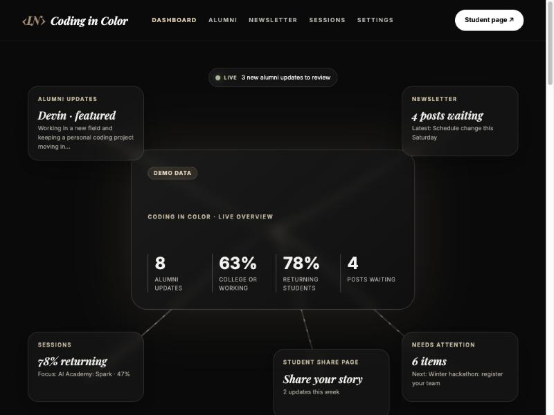

<!--
  TODO BEFORE 1:15 PM:
  [ ] Paste the video link                            [x] Screenshots added
  [ ] Repo is PUBLIC                                  [ ] Last commit before 1:30 PM
-->
# Coding in Color: Post-to-Newsletter

**Team:** Pranit (solo) · **Nonprofit:** Coding in Color
**Live app:** https://coding-in-color.coolpranit2009.workers.dev
**Video (3 min):** [unlisted YouTube / Drive link]

> *"Talent is everywhere. Accessibility isn't."* (Coding in Color's mission)

## The problem
Coding in Color makes coding accessible to K-12 students of color. Student and parent retention is low, and almost every announcement (sign-ups, schedule changes, showcases, field trips) goes out only on Instagram, so families who don't check Instagram miss them and drift away. Writing a separate newsletter takes time the team doesn't have. They also can't store student data like names, so any tool has to work without it.

## How it works
1. **Add an Instagram post:** paste the caption and drop in the photos and/or the reel. **Cloudflare Workers AI** reads the text inside flyers, describes the photos, and transcribes what's said in the reel. Staff can review and edit everything before saving.
2. **Build the newsletter:** tick the posts for the month and Workers AI (Llama 3.3 70B) writes a warm, skimmable family newsletter. Upcoming events and sign-ups come first, it uses only facts from the posts, and every section links back to its post. Copy it straight into Gmail or Mailchimp, copy plain text, or download it as HTML. A no-AI "simple version" always works as a fallback.
3. **Track retention without names:** after each session, log a headcount, how many came back from last time, and how many families came. The dashboard's **Needs attention** list flags sessions where fewer than half returned, plus event/sign-up posts from 2+ weeks ago that never made it into a newsletter.

## Tech stack
- **Cloudflare Workers:** serves the app plus a small REST API
- **Workers KV:** shared storage for posts, session headcounts and past newsletters
- **Workers AI:** `@cf/meta/llama-3.2-11b-vision-instruct` (image description + text in images), `@cf/openai/whisper-large-v3-turbo` (reel transcription, with fallback to `@cf/openai/whisper`), `@cf/meta/llama-3.3-70b-instruct-fp8-fast` (newsletter writing). AI is called **only from the Worker** (never the browser), with same-origin checks, size limits and rate limiting
- Front end: HTML, CSS and vanilla JavaScript in one file (`src/index.html`). The browser shrinks images and pulls 16 kHz audio out of reels before upload, and no photos or videos are stored
- `build/build_worker.py` bundles `src/index.html` into the deployable `worker.js`
- **Starter template and AI disclosure:** we began from a generic, config-driven starter template that Pranit prepared before the event (`src/presets/`, `build/`). Everything specific to Coding in Color was built during the hackathon: the post-to-newsletter flow, the media AI endpoints, anonymous retention tracking, and the config. Claude acted as architect and reviewer, and Codex implemented well-specified pieces through a JSON task protocol. All code was reviewed and tested.

## How to run it
- **Use it:** open the live link above.
- **Run locally:** open `src/index.html` in a browser (works offline with the no-AI newsletter; data stays in that browser), or `npm install && npm run dev`.
- **Deploy:** `npx wrangler login`, then `npm run deploy`. KV and Workers AI bindings are in `wrangler.toml`.
- **Tests:** `python3 build/build_worker.py && node tests/test_t3_media.mjs && node tests/test_t2_ai_actions.mjs && node tests/test_attention.mjs`
- **Adapt it:** everything the app tracks lives in `src/presets/coding_in_color.js` (apply with `python3 build/apply_preset.py src/presets/coding_in_color.js`).

## Status
**Finished (verified live on Workers AI):** image reading (description + text in images), reel transcription, AI newsletter writing; email-ready copy/download; no-AI fallback newsletter; anonymous session headcounts with returning % and family visits; Needs attention flags; posts, sessions and newsletters saved in KV; CSV import/export.
**Mocked up / demo only:** all posts and sessions are fake demo data; newsletters are copied into the org's own email tool, not sent by the app; reels longer than 2 minutes are trimmed to the first 2 minutes.
**Next:** pull posts automatically with Instagram's Graph API (needs the org's business account token); one-click send through Cloudflare Email or Mailchimp; Spanish and other translated editions for families (accessibility); staff login.

## Privacy note
No student names or personal data are stored, by design: retention uses headcounts only. Photos and videos are processed and then discarded; only the extracted text is kept. The AI prompts forbid naming people or guessing identities. Always review AI drafts before sending.

## License
MIT. See `LICENSE`.
