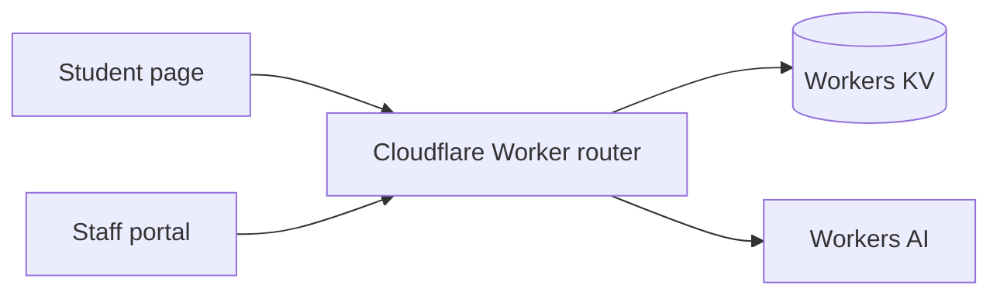

# Coding in Color: Alumni Impact + Family Newsletter

**Team:** Pranit (solo)

**Nonprofit:** Coding in Color, Arizona

**Live app:** [Student page](https://coding-in-color.coolpranit2009.workers.dev/) · [Staff portal](https://coding-in-color.coolpranit2009.workers.dev/staff) (demo staff passcode: `testpassword1`; fake demo data only, and a real deployment sets its own with `npx wrangler secret put STAFF_CODE`)

**Video (3 min):** https://youtu.be/ouxasGMSUKY

**Repository:** [github.com/CoolBro34/firebytes-hackathon](https://github.com/CoolBro34/firebytes-hackathon)

> “Talent is everywhere, opportunity is not.” (Coding in Color)

## The problem

Coding in Color's biggest problem is not knowing what students do after they leave, which makes it hard to show the impact of its programs. Announcements live on Instagram, so families can miss them, and the nonprofit cannot store current students' names. Coding in Color reports 500+ students since 2024 and 80%+ from historically underserved backgrounds.

## How it works

Former students can voluntarily share an update through the student page. Staff review alumni updates, record anonymous session counts, and turn manually entered Instagram posts into a bilingual family newsletter draft.


Staff can use the dark gold dashboard's live overview and five shortcuts to Alumni, Newsletter, Sessions, Needs attention, and the student page. The consent-only alumni wall uses a WebGL gallery; the Alumni updates page has filters, private tags, and an age column. Newsletter tools can extract text from an Instagram image, transcribe reel audio, write a newsletter with AI, translate it to Spanish, and copy it for Campaign Monitor. Its signup form supports EN/ES.

## Tech stack

- Cloudflare Workers serves the pages and API; Workers KV stores records.
- Workers AI models: `@cf/meta/llama-3.3-70b-instruct-fp8-fast` writes newsletters, translates them, and handles text drafts; `@cf/meta/llama-3.2-11b-vision-instruct` describes images and reads their text; `@cf/openai/whisper-large-v3-turbo` transcribes audio, with `@cf/openai/whisper` as fallback.
- OGL renders the alumni gallery. The UI is plain HTML, CSS, and JavaScript; it has no framework or UI build step. `npm run dev` bundles the Worker first.

## Try it in 2 minutes (for judges)

1. Open the [student page](https://coding-in-color.coolpranit2009.workers.dev/), share a story, and try “under 18” to see the parent-email gate.
2. Open the [staff portal](https://coding-in-color.coolpranit2009.workers.dev/staff), enter demo passcode `testpassword1`, and see the update reflected in the LIVE overview and Alumni satellite. The demo data is fake.
3. Open Newsletter, click **✨ Write newsletter with AI**, switch to **Español**, then **Copy for Campaign Monitor**. **Settings → Reset demo data** restores the demo.

## Architecture



The Worker serves the student and staff HTML pages and routes API requests. Public submissions are validated by the Worker; an optional photo is sent to image description and only the resulting text can be stored. Staff API requests use the shared passcode when `STAFF_CODE` is configured. Entity records are stored as JSON arrays in KV; AI receives bounded text and media inputs for the relevant action.

## API reference

With `STAFF_CODE` configured, routes marked **Staff** require the `x-staff-code` header. Otherwise the demo API is unlocked. Same-origin checks apply to AI/media/newsletter and alumni submission routes when an `Origin` header is present. `OPTIONS` returns the Worker CORS preflight response.

| Method | Route | Auth | Purpose |
|---|---|---|---|
| GET | `/api/capabilities` | Public | Report configured storage, AI, media, and staff lock. |
| GET | `/api/ping` | Public | Check KV availability. |
| GET | `/api/public/programs` | Public | Return allowed alumni program names. |
| POST | `/api/alumni/submit` | Public | Submit a voluntary alumni update; requires age confirmation (18+ or parent/guardian permission), and a parent email for under-18 submitters. |
| POST | `/api/ai` | Staff | Generate one of the allowlisted text drafts. |
| POST | `/api/media/describe` | Staff | Describe an image and extract readable text. |
| POST | `/api/media/transcribe` | Staff | Transcribe audio. |
| POST | `/api/newsletter` | Staff | Draft a newsletter from 1–12 supplied posts. |
| POST | `/api/newsletter/translate` | Staff | Translate a newsletter into Spanish and preserve its links. |
| GET, POST | `/api/<entity>` | Staff | List or create records for an entity. |
| GET, PUT, DELETE | `/api/<entity>/<id>` | Staff | Read, update, or delete one record. |
| GET | `/api/_export` | Staff | Export all entity arrays. |
| POST | `/api/_reset` | Staff | Replace stored entity arrays. |

The Worker also responds to `GET` and `HEAD` for `/` and `/share` with the student page, and `/staff` with the staff app. Unknown API routes return not found; unsupported methods return method not allowed.

## Data and privacy

| Entity | Stored in KV |
|---|---|
| `update` | Submission time and status; optional first name, alumni program and outcome details, story and links; consent flags; parent email only for under-18 submissions; contact only when contact consent is selected; optional AI image description. |
| `post` | Manually entered post title, date, kind, link, caption, image notes, transcript, and used flag. |
| `session` | Date, program, aggregate headcount and returning count, families count, and optional notes. |
| `issue` | Newsletter subject, period, creation time, post count, source label, and newsletter text. |

The app never stores photos, audio, or names of current students. Alumni first name is optional. Parent email is collected only for under-18 submitters and is visible to staff. Consent flags control public wall and newsletter inclusion; staff review status also filters what appears on the wall. The shared staff passcode is a Cloudflare secret. The public form has a honeypot, and AI-backed routes use same-origin checks and a best-effort rate limit when KV is available. Prompts tell models to treat submitted records as data, not instructions.

## Project structure

```text
.
├── src/index.html                 # Staff portal shell and application
├── src/share.html                 # Public alumni submission page
├── src/presets/coding_in_color.js # Active preset, views, and OGL gallery
├── src/presets/                   # Other reusable starter presets
├── src/worker/index.js            # Router and API auth gate
├── src/worker/alumni.js           # Public program list and alumni submission
├── src/worker/ai.js               # Allowlisted text drafts and rate limit
├── src/worker/auth.js             # Staff passcode and public route list
├── src/worker/http.js             # JSON, body, ID, and validation helpers
├── src/worker/media.js            # Image, audio, and newsletter generation
├── src/worker/pages.js            # HTML page responses
├── src/worker/storage.js          # KV entity CRUD, export, and reset
├── src/worker/translate.js        # Spanish newsletter translation
├── tests/run_all.mjs              # Runs each test suite
├── tests/test_attention.mjs       # Needs-attention behavior
├── tests/test_t2_ai_actions.mjs   # Allowlisted text drafting
├── tests/test_t3_media.mjs        # Media and newsletter API
├── tests/test_t5_alumni.mjs       # Alumni submission and staff lock
├── tests/test_t8_gallery.mjs      # Consent-aware gallery behavior
├── tests/test_t9_translate.mjs    # Newsletter translation
├── tests/test_t11_staff_ui.mjs    # Staff portal UI behavior
├── tests/test_t13_age.mjs         # Age confirmation and parent email
├── screenshots/share.jpg          # Current student page screenshot
├── screenshots/dashboard.jpg      # Current dashboard screenshot
├── build/build_worker.py          # Bundles Worker and embedded pages
├── package.json                   # Build, dev, deploy, and test scripts
├── wrangler.toml                  # Worker bindings and configuration
├── LICENSE                        # MIT license
└── worker.js                      # Generated Worker bundle
```

## Run, test, deploy

```sh
npm install
npm test
npm run dev
npx wrangler login
npx wrangler kv namespace create DATA
npx wrangler secret put STAFF_CODE
npm run deploy
```

Set the KV namespace ID created by Wrangler in `wrangler.toml`. The demo passcode above is for fake demo data; real deployments set their own `STAFF_CODE` secret.

## How we built it

We started from Pranit's pre-event config-driven starter template. We spoke with the nonprofit in person and pivoted to the problem it identified. Claude served as architect and reviewer; Codex built tasks specced in the JSON task protocol, then Claude reviewed and tested them, catching several bugs. The gallery adapts an open-source CircularGallery OGL component, ported to vanilla JavaScript.

## Status

**Finished:** voluntary alumni updates with consent controls; staff review and dashboard; anonymous session headcounts; manual Instagram post entry; image text/description and reel transcription; AI newsletter drafts, Spanish translation, and Campaign Monitor copy workflow.

**Mocked/demo:** all included records are fake. Instagram posts are pasted, not imported automatically. Newsletter drafts are copied into Campaign Monitor, not sent. Parent permission is self-reported and the email is collected, not verified. Staff share one passcode rather than using individual accounts.

**Next:** Instagram Graph API import, Campaign Monitor API sending, per-staff logins, parent email verification, and more languages.

## License

MIT. See [LICENSE](LICENSE).
